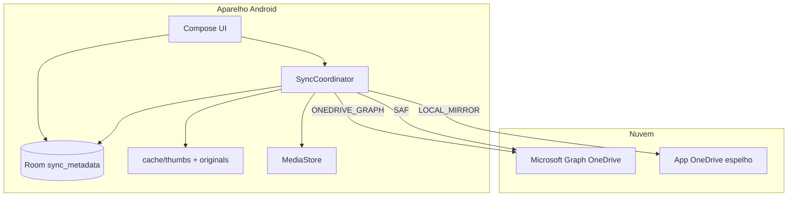

# Arquitetura — OneGallery Sync

## Objetivo do produto

Galeria Android **nativa** (Kotlin + Jetpack Compose) que substitui a integração descontinuada **Galeria Samsung ↔ OneDrive**, com:

- Sincronização **bidirecional** com Microsoft OneDrive (modo Graph) ou alternativas SAF / espelho local.
- Indexação de **toda mídia visível** no MediaStore (DCIM, WhatsApp, Downloads, etc., conforme permissões).
- **Uma grade** para itens locais e só na nuvem, com originais **sob demanda**.
- Álbuns por pasta, lugares (GPS), álbuns do usuário, mapa, aba de status de sync.

Documentação detalhada por tema: [README.md](README.md).

## Princípio central

```text
         ┌─────────────────────────────────────┐
         │         sync_metadata (Room)         │
         │  índice único: local + nuvem + meta  │
         └─────────────────────────────────────┘
              ▲                    │
              │ upsert/reconcile   │ observe (debounced)
              │                    ▼
    ┌─────────────────┐    ┌──────────────────┐
    │ SyncCoordinator │    │  GalleryViewModel │
    └─────────────────┘    └──────────────────┘
              ▲                    │
   MediaStore │ Graph/SAF/Mirror   ▼
              │              Compose UI
```

Tudo que a galeria mostra passa por **`SyncMetadataEntity`**. MediaStore e OneDrive são **fontes** que o coordinator alinha com essa tabela.

## Camadas

| Camada | Pacote / pasta | Responsabilidade |
|--------|----------------|------------------|
| UI | `ui/` | Compose, navegação, interação |
| Sync | `sync/` | Orquestração, política, estado de sync, foreground |
| Dados locais | `data.local/` | MediaStore, cache, EXIF/GPS, exclusão scoped |
| Persistência | `data.local.db/` | Room DAOs/entities |
| Nuvem | `data.onedrive/` | Graph API, SAF, espelho Pictures |
| Auth | `auth/` | MSAL, tokens Graph |
| Background | `worker/` + receivers | WorkManager, boot, watcher |

## Componentes singleton (Application)

`OneGalleryApplication` constrói e expõe:

- `AppDatabase`, `SyncMetadataDao`, `UserAlbumDao`
- `LocalMediaRepository`, `MediaCacheRepository`
- `OneDriveRepository`, `SaOneDriveRepository`, `LocalMirrorRepository`
- `SyncCoordinator` (coração do sync)
- `SyncPreferences`, prefs de pasta Graph/SAF
- `MsalAuthManager`
- `MediaLibraryChangeWatcher`
- `SyncTaskLauncher`

Também: Coil, MapLibre, guard de rede Wi‑Fi, re-agendamento de background sync.

## SyncCoordinator (resumo)

Uma classe (~3500 linhas) concentra:

- Indexação local e listagem remota
- Reconciliação upload/download/delete **lógico**
- Estado `SyncUiState` (fase, fila, transferências ativas, mensagens)
- Flows: `galleryMetadata`, `albumCoverRevisions`, `galleryDisplayRefreshEpoch`
- Pós-sync: miniaturas, capas, GPS, datas
- APIs de UI: álbuns usuário, mover itens, download original, exclusões

Concorrência:

- **`longTaskMutex`**: um pipeline longo por vez
- Semáforos para uploads (3) e miniaturas (3)
- Lista **`activeSyncItemsBacking`** separada do StateFlow para progresso paralelo sem race

Detalhe das fases: [SYNC_PIPELINE.md](SYNC_PIPELINE.md).

## Modos de nuvem

Enum `SyncMode`: `LOCAL_ONLY`, `ONEDRIVE_LOCAL_MIRROR`, `ONEDRIVE_FOLDER`, `ONEDRIVE_GRAPH`.

O coordinator escolhe implementação em `listRemoteFiles`, `uploadLocalFile`, `downloadRemoteFile`, `deleteRemoteFile`.

Referência: [ONEDRIVE_INTEGRATION.md](ONEDRIVE_INTEGRATION.md).

## UI da galeria

- **`GalleryMapper`**: Entity → `GalleryDisplayItem` (thumb model, URIs, badges).
- **`GalleryBrowseVisibility`**: cloud-only exige miniatura em cache.
- **`GalleryViewModel`**: combine metadata + prefs + revisões de capa → `GalleryUiState`.

Referência: [GALLERY_AND_ALBUMS.md](GALLERY_AND_ALBUMS.md).

## Background

WorkManager 15 min + one-shot debounced; boot; MediaStore observer; callback de rede.

Referência: [BACKGROUND_AND_TRIGGERS.md](BACKGROUND_AND_TRIGGERS.md).

## Segurança e exclusões

Exclusões usam `pendingDeleteTarget` + confirmação. Android 11+ delete scoped via `MediaDeleteRequestRouter`.

Referência: [DELETES_AND_SPACE.md](DELETES_AND_SPACE.md).

## Diagrama de deploy lógico



## Escopo e limitações honestas

| Área | Nota |
|------|------|
| Conflitos | Timestamps + QuickXorHash; casos extremos podem precisar sync manual |
| WhatsApp / OEM | Visibilidade depende de permissões e fabricante |
| Graph | Requer app registrado no Entra ID |
| Volume enorme | Prefetch de miniaturas limitado por passagem; múltiplos syncs completam o índice |
| Paridade Samsung | Objetivo funcional, não certificação oficial Microsoft/Samsung |

`SyncCapability.bidirectionalSyncEnabled = true` no código.

## Onde ler a seguir

1. [SYNC_PIPELINE.md](SYNC_PIPELINE.md) — fluxo completo
2. [DATA_AND_INDEX.md](DATA_AND_INDEX.md) — schema e estados
3. [CONFIGURATION_REFERENCE.md](CONFIGURATION_REFERENCE.md) — números e limites
4. [DEVELOPMENT.md](DEVELOPMENT.md) — build e release
