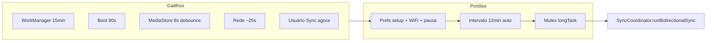

# Sincronização em segundo plano e gatilhos

## Objetivo

Manter o índice `sync_metadata` alinhado com MediaStore e OneDrive **sem exigir que o app esteja aberto**, respeitando Wi‑Fi, pausa manual e anti-loop.

## Componentes

| Componente | Arquivo | Função |
|------------|---------|--------|
| WorkManager periódico | `worker/SyncWorker.kt` | Chama `runBidirectionalSync(userInitiated = false)` |
| Agendador | `worker/BackgroundSyncScheduler.kt` | Periodic 15 min + one-shot com delay |
| Boot | `sync/BootCompletedReceiver.kt` | Após boot/update, sync ~90 s depois |
| MediaStore | `sync/MediaLibraryChangeWatcher.kt` | ContentObserver imagens/vídeos |
| Rede | `OneGalleryApplication.registerWifiSyncNetworkGuard` | Callback de rede padrão |
| Foreground | `sync/SyncForegroundService.kt` + `SyncForegroundGuard` | Notificação durante sync longo |

## WorkManager

### Trabalho periódico

- **Nome único:** `onegallery_bidirectional_sync` (`SyncWorker.UNIQUE_NAME`).
- **Intervalo:** 15 minutos (`PeriodicWorkRequestBuilder`).
- **Rede:** `UNMETERED` se “só Wi‑Fi” ligado; senão `CONNECTED`.

### Trabalho imediato (debounced)

- **Nome único:** `onegallery_bidirectional_sync_now` (`IMMEDIATE_UNIQUE`).
- **Delay padrão:** 30 s (`enqueueSyncSoon`); **REPLACE** reinicia o timer se houver rajada de eventos.
- **Cooldown:** se cair no intervalo mínimo (12 min, ou **3 min** com envios/downloads pendentes), agenda `onegallery_bidirectional_sync_deferred` (KEEP) em vez de descartar o gatilho.
- Usado por: watcher de biblioteca, callback de rede (~25 s), boot.

### Pré-condições (não enfileira se)

- `backgroundSyncAlwaysEnabled == false`
- Setup incompleto (`hasCompletedSetup == false`)
- `isAutoSyncPaused()` (usuário pausou)
- `shouldDeferBackgroundSyncByTime()` (cooldown pós-cancelamento / intervalo mínimo entre auto-sync)

## Boot e atualização do app

`BootCompletedReceiver` escuta:

- `BOOT_COMPLETED`, `LOCKED_BOOT_COMPLETED`
- `MY_PACKAGE_REPLACED`
- `QUICKBOOT_POWERON` (alguns OEMs)

→ `BackgroundSyncScheduler.onDeviceBoot` → sync atrasado **90 s**.

## MediaLibraryChangeWatcher

- Observa URIs de imagens e vídeos no MediaStore.
- **Debounce:** 8 s (`DEBOUNCE_MS`) antes de reagir.
- Enfileira sync com delay **30 s** (`LIBRARY_CHANGE_DELAY_SEC`) para agrupar imports (WhatsApp, câmera).
- **Suprimido** enquanto sync está rodando e por janelas após sync / liberação de espaço (evita ciclo infinito).

## Callback de rede (`OneGalleryApplication`)

- Quando a rede fica disponível e válida → `enqueueSyncSoon` (~25 s).
- Se política Wi‑Fi-only e rede é medida → pode cancelar sync em andamento.

## Foreground service

- Tipo `dataSync` (Android 14+).
- Ref-count em `SyncForegroundGuard`: várias fases podem compartilhar a mesma notificação.
- Canal: `onegallery_sync`, notification id `4101`.

## Liga/desliga “sempre em segundo plano”

`BackgroundSyncScheduler.applyAlwaysOnPolicy`:

- **Ligado:** periodic WorkManager + `mediaLibraryChangeWatcher.start()`.
- **Desligado:** cancela works únicos/periódicos + `watcher.stop()`.

Chamado em `OneGalleryApplication.rescheduleBackgroundSync()` quando preferências mudam.

## Sync manual

- Aba **Sync** ou **Ajustes** → `userInitiated = true` (ignora alguns deferrals de tempo, mas ainda respeita mutex e rede).
- Primeiro sync após permissões: `OneGalleryApp.triggerInitialAutoSyncIfReady()` (uma vez, coordenado com ViewModel para não duplicar).

## Diagrama simplificado

Ver também limites numéricos em [CONFIGURATION_REFERENCE.md](CONFIGURATION_REFERENCE.md).
