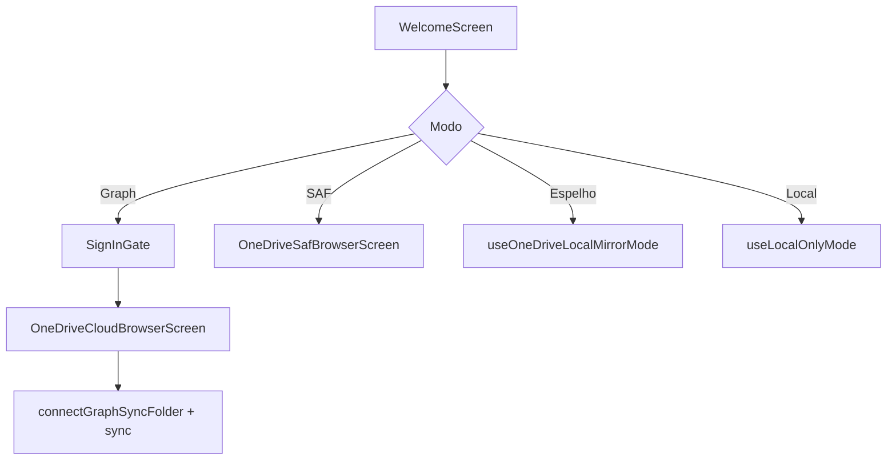

# Integração OneDrive

Quatro modos em `SyncMode` (`sync/SyncMode.kt`). O coordinator delega listagem, upload, download e delete conforme o modo ativo em `SyncPreferences`.

## Comparativo

| Modo | Como o usuário configura | Backend no código |
|------|--------------------------|-------------------|
| `LOCAL_ONLY` | Sem nuvem | Nenhum remoto |
| `ONEDRIVE_LOCAL_MIRROR` | Pasta `Pictures/OneGallerySync` + app OneDrive | `LocalMirrorRepository` |
| `ONEDRIVE_FOLDER` | Seletor SAF (My Files / OneDrive) | `SaOneDriveRepository` + URI persistida |
| `ONEDRIVE_GRAPH` | Login Microsoft + pasta na nuvem | `OneDriveRepository` + MSAL |

## Modo Graph (recomendado para “estilo ES File Explorer”)

### Autenticação

- **MSAL** (`auth/MsalAuthManager.kt`), scopes Graph para arquivos.
- Client ID em build: `msal.properties` → `BuildConfig` (ver [BUILTIN_MSAL.md](BUILTIN_MSAL.md)).
- Redirect: `msauth://…` + `BrowserTabActivity` no manifest.

### Pasta de sync

- Usuário escolhe pasta em `OneDriveCloudBrowserScreen`.
- Preferências: `GraphFolderPreferences` (item id, path exibido, **delta link**, timestamp última listagem completa).

### Listagem remota

Implementação em `OneDriveRepository`:

1. **Delta query** quando possível (rápido, incremental).
2. Se delta omitir caminhos ou pular itens → **listagem recursiva suplementar**.
3. **Listagem completa recursiva** no máximo a cada **24 h** (`FULL_REMOTE_LISTING_INTERVAL_MS`).
4. Resolução de caminho canônico: walk de pais até a raiz de sync (`PARENT_WALK_MAX_DEPTH` = 48).
5. Vincula linhas Room existentes ao `oneDriveItemId` remoto quando o path bate.

### Upload

- **≤ 4 MiB:** upload simples (`GraphResumableTransfer.SIMPLE_UPLOAD_MAX_BYTES`).
- **Maior:** sessão de upload resumável com fragmentos; estado opcional em `UploadSessionStore`.
- Progresso reportado para `SyncCoordinator.activeItems`.

### Download

- Original: download resumável com Range + progresso.
- Miniatura: endpoint Graph thumbnail (large/medium) ou prefixo de imagem (0–2 MiB) para decode local.
- Probe EXIF/GPS na nuvem: **512 KiB** (`EXIF_PROBE_BYTES`) do início/fim do arquivo.

### HTTP

- Cliente OkHttp dedicado com timeouts (connect 30 s, read/write 90 s, call 120 s) para não bloquear slots paralelos indefinidamente.

## Modo SAF (`ONEDRIVE_FOLDER`)

- Usuário concede árvore via Storage Access Framework.
- `OneDriveFolderPreferences` guarda URI persistível.
- Operações via `DocumentFile` — depende do provedor (Samsung My Files, etc.).

## Modo espelho local (`ONEDRIVE_LOCAL_MIRROR`)

- Copia arquivos para `Pictures/OneGallerySync/`.
- App **OneDrive** da Microsoft faz upload automático para a nuvem.
- Sem MSAL no fluxo de transferência direta.

## Política de pasta

- Nome padrão de espelhamento: **`OneGallerySync`** (`SyncPolicy.ONEDRIVE_MIRROR_ROOT`).
- Caminhos relativos preservam estrutura (ex.: WhatsApp dentro de Pictures).

## Setup na UI

## Diagnóstico

- `SyncSetupDiagnostics` — factory para mensagens de setup.
- Aba Sync mostra erros de sessão, rede e fila pendente.

## Documentos Azure relacionados

- [MICROSOFT_APP_REGISTRATION.md](MICROSOFT_APP_REGISTRATION.md)
- [AZURE_PERMISSIONS.md](AZURE_PERMISSIONS.md)
- [AZURE_REDIRECT.md](AZURE_REDIRECT.md)
