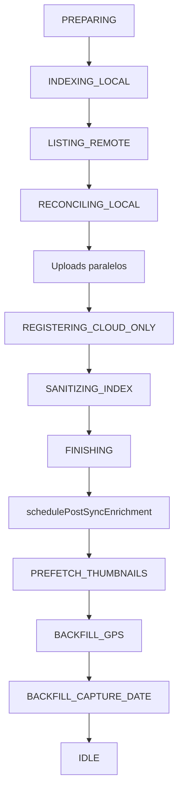

# Pipeline de sincronização

O motor central é `SyncCoordinator` (`app/src/main/java/com/onegallery/sync/sync/SyncCoordinator.kt`). Toda operação pesada passa por coroutines no escopo da aplicação, com **`longTaskMutex`** para evitar dois syncs completos ao mesmo tempo.

## Entradas públicas principais

| Método | Uso |
|--------|-----|
| `runBidirectionalSync(userInitiated)` | Sync completo aparelho ↔ nuvem |
| `indexLocalLibrary()` | Só reindexar MediaStore → Room |
| `runPostSyncEnrichment` (interno/agendado) | Miniaturas, capas, GPS, datas após o núcleo |
| `ensureThumbnailCached(path)` | Uma miniatura (grade, detalhe, prefetch) |
| `downloadOriginalOnDemand` / `recallOriginalToDevice` | Original completo |
| `resolvePendingDelete` / `requestDelete` | Propagação de exclusões após confirmação |

`SyncTaskLauncher` encapsula chamadas a partir da UI/WorkManager com registro de jobs canceláveis.

## Fases do sync bidirecional

Estados expostos em `SyncUiState.progressPhase` (`SyncProgressPhase`):

### 1. Preparação (`PREPARING`)

- Verifica modo configurado (`SyncMode`), sessão Graph (se aplicável), rede e política **só Wi‑Fi**.
- `SyncForegroundGuard` inicia notificação / `SyncForegroundService` durante trabalho longo.
- Flush de exclusões legadas pendentes, rebuild de índice se a pasta raiz na nuvem mudou.

### 2. Indexação local (`INDEXING_LOCAL`)

- `LocalMediaRepository` varre **imagens e vídeos** via MediaStore.
- `SyncPolicy.shouldIncludeLocalItem` exclui lixeira e caminhos irrelevantes.
- Upsert em `sync_metadata` por **`canonicalPath`** (ver [DATA_AND_INDEX.md](DATA_AND_INDEX.md)).
- Caminhos WhatsApp e pastas do usuário são normalizados em `SyncPaths`.

### 3. Listagem remota (`LISTING_REMOTE`)

Depende de `SyncPreferences.syncMode` (ver [ONEDRIVE_INTEGRATION.md](ONEDRIVE_INTEGRATION.md)):

- **Graph:** delta quando há `deltaLink` válido; listagem recursiva complementar se delta incompleto ou a cada ~24 h; resolução de caminho canônico via walk de pais.
- **SAF / espelho local:** listagem no backend correspondente.

Resultado: snapshot de arquivos remotos com id, hash QuickXor, tamanho, data de modificação.

### 4. Reconciliação (`RECONCILING_LOCAL`)

Para cada linha local indexada:

- Se não existe remoto → candidato a **upload**.
- Se existe remoto → compara timestamp (tolerância ~2 s), tamanho e **QuickXorHash** quando disponível.
- Nuvem mais nova → `PENDING_DOWNLOAD` ou placeholder (miniatura primeiro, original sob demanda).
- Local mais novo → upload (resumável acima de 4 MiB no Graph).
- Detecção de arquivo removido de um lado → `pendingDeleteTarget` (LOCAL / REMOTE / BOTH) **sem apagar até confirmação**.

Uploads em lote: **`PARALLEL_UPLOADS = 3`**, com barras de progresso na aba Sync (`activeItems`).

### 5. Registro só na nuvem (`REGISTERING_CLOUD_ONLY`)

- Arquivos presentes no drive sem par local → `CloudSyncState.CLOUD_ONLY`.
- Não baixa o original automaticamente; miniatura entra no pós-sync.

### 6. Sanitização (`SANITIZING_INDEX`)

- `SyncIndexMaintenance`: duplicatas, órfãos, linhas inconsistentes após reconciliação.

### 7. Finalização e pós-sync

- `FINISHING`: mensagem resumida, contagem de pendentes.
- **Pós-sync inline:** miniaturas/GPS rodam **na mesma sessão** do sync (mutex + foreground service), para não parar ao minimizar o app entre o núcleo e as miniaturas.

#### Pós-sync (`runPostSyncEnrichmentInternal`)

1. Fila residual (exclusões pendentes, itens sem miniatura).
2. **`drainRemainingRunQueueBeforePrefetch`**: confirma exclusões; miniaturas da fila em levas com **`runMissingThumbnailPrefetch`** (3 em paralelo), não uma a uma.
3. **`ensureAlbumCoverThumbnails`**: uma miniatura prioritária por álbum.
4. **`prefetchMissingThumbnails`**: levas de até 512 itens, **3 em paralelo**, limites por passagem (ver [THUMBNAILS_CACHE_AND_DOWNLOADS.md](THUMBNAILS_CACHE_AND_DOWNLOADS.md)).
5. **`backfillMissingGpsLocations`**: EXIF local + probe na nuvem (~512 KiB).
6. **`backfillMissingCaptureTimes`**: ordenação por data de captura na galeria.

## UI de progresso (aba Sync)

- **`activityHeadline` / `activityDetail`**: texto principal da fase.
- **`activeItems`**: até N transferências ativas com bytes (lista autoritativa em memória + publish coalescido na main thread).
- **`runQueue`**: fila da leva atual (miniaturas / residual).

## Cancelamento e limites automáticos

- Cancelamento pelo usuário: cooldown (`CANCEL_COOLDOWN_MS`), jobs filhos cancelados.
- Sync automático: intervalo mínimo **12 min** entre bidirecionais (`AUTO_BIDIRECTIONAL_MIN_INTERVAL_MS`).
- Durante sync: **MediaStore watcher suprimido** para evitar loop; idem após liberação de espaço local (janelas em [CONFIGURATION_REFERENCE.md](CONFIGURATION_REFERENCE.md)).

## Mutex e concorrência

| Recurso | Regra |
|---------|--------|
| `longTaskMutex` | Um sync completo ou enrichment longo por vez |
| `PARALLEL_UPLOADS` | 3 uploads Graph simultâneos |
| `PARALLEL_THUMBNAILS` | 3 downloads/gerações de miniatura simultâneos |
| `galleryMetadata` | Flow Room com debounce 450 ms para não recomputar UI a cada upsert |

## Flag de capacidade

`SyncCapability.bidirectionalSyncEnabled = true` — sync bidirecional está ligado no código; o comportamento real ainda depende de permissões, conta Microsoft e volume de mídia no dispositivo.
